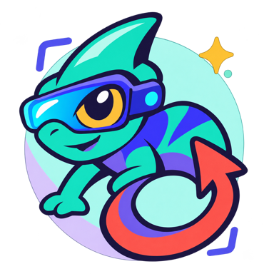
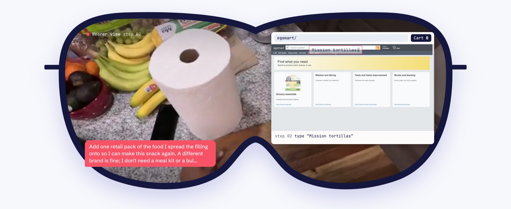
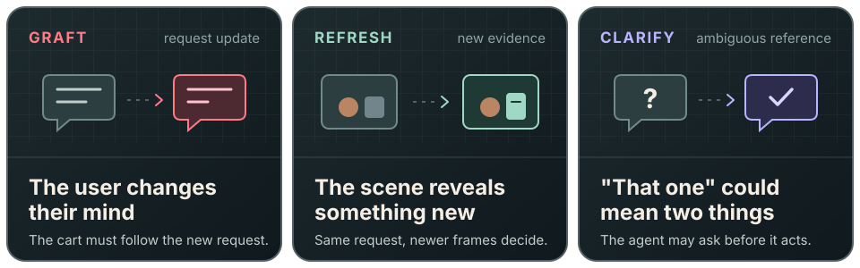
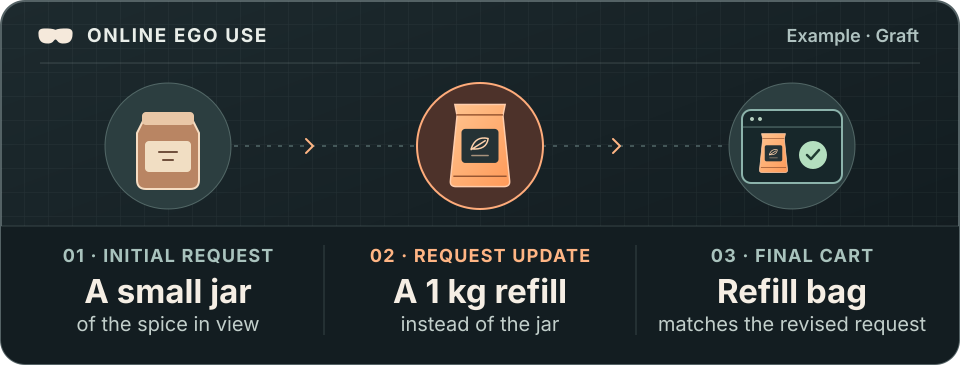

<p align="center">
  
</p>

<h1 align="center">EgoUseBench</h1>

<p align="center"><strong>Benchmarking computer-use agents under evolving first-person contexts</strong></p>

<p align="center">
  <strong>English</strong> · <a href="README.zh-CN.md">简体中文</a>
</p>

<p align="center">
  
  
  <a href="LICENSE"></a>
</p>

<p align="center">
  <a href="#benchmark">Benchmark</a> ·
  <a href="#quick-start">Quick start</a> ·
  <a href="#repository-layout">Repository layout</a> ·
  <a href="#release-status">Release status</a>
</p>

<p align="center">
  
  <br>
  <sub>The wearer asks for "one retail pack of the food I spread the filling onto" while the agent shops on EgoMart. Footage: CaptainCook4D (Apache 2.0).</sub>
</p>

**EgoUseBench** tests whether computer-use agents keep up when first-person observations or user requests change during a task. Agents find products, save tutorials, or bookmark places on local websites. A task succeeds only if the final website state meets the user's *current* request.

<p align="center"><strong>693 task instances</strong> &nbsp;·&nbsp; <strong>74+ hours of source recordings</strong> &nbsp;·&nbsp; <strong>3 interaction settings</strong> &nbsp;·&nbsp; <strong>3 local websites</strong></p>

## Benchmark

<p align="center">
  
</p>

The three settings share the same **200 tasks** for matched comparisons. Online Ego Use adds **93 composite tasks** that combine several change types.

| Setting | What the agent receives | Tasks |
| --- | --- | ---: |
| **Computer-Use** | Explicit final requirements, without first-person footage | 200 |
| **Offline Ego Use** | First-person footage before execution, plus the user's requests | 200 |
| **Online Ego Use** | First-person observations and user requests as execution unfolds | 293 |

A Graft task end to end: the request changes mid-task, and only the final cart is scored.

<p align="center">
  
</p>

Agents act on three self-hosted websites built from frozen real catalogs:

| Website | Modeled after | What the agent does |
| --- | --- | --- |
| **EgoMart** | Online store | Add the item the wearer is using to the cart |
| **EgoMedia** | Video platform | Save a tutorial for the activity underway |
| **EgoMaps** | Map service | Bookmark a place that fits the request |

## Quick start

One command installs everything, including the test suite. You need [uv](https://docs.astral.sh/uv/) and Python 3.11+.

```bash
uv sync
uv run playwright install chromium   # once, for browser tests
uv run pytest -q             # offline tests
uv run python -m website     # project site at http://127.0.0.1:5050 (set WEBSITE_PORT to change)
```

**Evaluate an agent.** Evaluation also needs the task media from the data package (not yet public), Google Chrome, and an OpenAI-compatible endpoint.

```bash
cp .env.example .env        # set OPENAI_BASE_URL and OPENAI_API_KEY

# Freeze an experiment from the registered protocol, then run it.
uv run python -m egocua.study_cli --model <model> --export experiments/
uv run python -m egocua.study_cli --study-from experiments/<frozen-dir> --run-all

# Inspect one run: inputs, actions, final state, and score.
uv run egocua inspect-run <run-dir> --view score
```

Each run is capped at 20 steps (30 for composite tasks), and the checker scores the final website state. Run `uv run egocua --help` to list all commands.

## Repository layout

| Path | Contents |
| --- | --- |
| [`egocua/`](egocua/) | Timeline replay, agent adapters, execution loop, and final-state checker |
| [`sites/`](sites/) | EgoMart, EgoMedia, and EgoMaps with their frozen catalogs |
| [`data/tasks/`](data/tasks/) | Compiled task definitions |
| [`data/experiments/`](data/experiments/) | Interaction-setting requests, composite tasks, and controlled variants |
| [`configs/`](configs/) | Evaluation protocol and source-dataset registry |
| [`tools/`](tools/) | Task mining, catalog building, auditing, and rendering scripts |
| [`website/`](website/) | Project-site source |
| [`tests/`](tests/) | Offline test suite (`uv run pytest`) |

## Release status

| Surface | What belongs there |
| --- | --- |
| **GitHub** | Evaluation code, task definitions, frozen website catalogs, and project-site source |
| **Hugging Face** | Matching task and website snapshots, plus observation frames, clips, and site media cleared for redistribution. *Pending.* |
| **Project site** | Benchmark overview and task breakdowns. Evaluation results and model replays are held back for now. |

Restricted Ego2Web, Ego4D-derived, and EgoLife footage stays under the original providers' access terms. See the [source registry](configs/datasets.json) for each dataset's license.

## License

The code is released under the [MIT License](LICENSE). First-person footage and website media keep the licenses of their original sources, as listed in [`configs/datasets.json`](configs/datasets.json).
