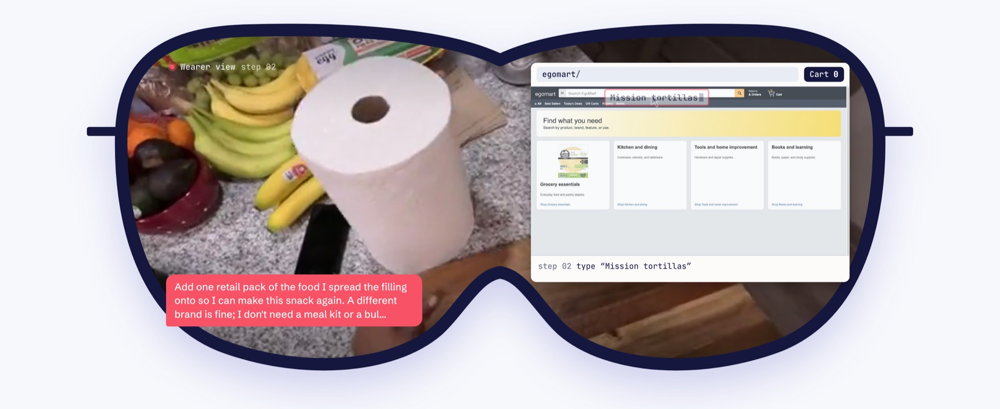
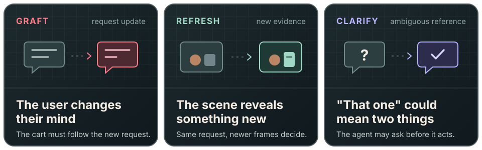
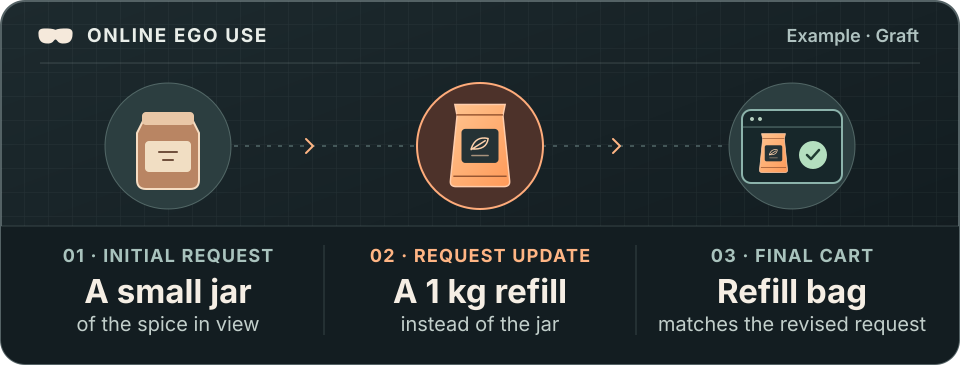

<p align="center">
  
</p>

<h1 align="center">EgoUseBench</h1>

<p align="center"><strong>在不断变化的第一人称情境中评测电脑操作智能体</strong></p>

<p align="center">
  <a href="README.md">English</a> · <strong>简体中文</strong>
</p>

<p align="center">
  
  
  <a href="LICENSE"></a>
</p>

<p align="center">
  <a href="#基准概览">基准概览</a> ·
  <a href="#快速开始">快速开始</a> ·
  <a href="#目录结构">目录结构</a> ·
  <a href="#发布情况">发布情况</a>
</p>

<p align="center">
  
  <br>
  <sub>佩戴者说"买一包刚才抹馅料用的那种食物"，智能体同时在 EgoMart 上搜索。画面来自 CaptainCook4D（Apache 2.0）。</sub>
</p>

**EgoUseBench** 测试电脑操作智能体在任务进行中遇到第一人称画面或用户要求变化时，能否及时跟上。智能体在本地网站上找商品、收藏教程或标记地点；只有最终网站状态满足用户**当前**的要求，任务才算完成。

<p align="center"><strong>693 条任务</strong> &nbsp;·&nbsp; <strong>74 小时以上源录像</strong> &nbsp;·&nbsp; <strong>3 种交互设置</strong> &nbsp;·&nbsp; <strong>3 个本地网站</strong></p>

## 基准概览

<p align="center">
  
</p>

三种设置共用同一批 **200 条任务**，便于对照比较。Online Ego Use 另含 **93 条组合任务**，同一任务中叠加多种变化。

| 设置 | 智能体收到什么 | 任务数 |
| --- | --- | ---: |
| **Computer-Use** | 明确的最终要求，没有第一人称画面 | 200 |
| **Offline Ego Use** | 执行前给出第一人称录像，以及用户的要求 | 200 |
| **Online Ego Use** | 第一人称画面和用户要求随执行过程陆续到达 | 293 |

三种变化：

- **Graft**：用户中途更新要求。
- **Refresh**：要求不变，新的画面带来新证据。
- **Clarify**：指代有歧义时，智能体可以向用户提问。

下图是一条 Graft 任务的完整过程：要求在中途改变，只按最终购物车评分。

<p align="center">
  
</p>

智能体在三个自托管网站上操作，网站数据来自冻结的真实商品、视频和地点目录：

| 网站 | 对应类型 | 智能体要做什么 |
| --- | --- | --- |
| **EgoMart** | 电商 | 把佩戴者正在用的商品加入购物车 |
| **EgoMedia** | 视频平台 | 收藏与当前活动对应的教程 |
| **EgoMaps** | 地图服务 | 标记符合要求的地点 |

## 快速开始

一条命令装好全部依赖，包括测试。需要 [uv](https://docs.astral.sh/uv/) 和 Python 3.11+。

```bash
uv sync
uv run playwright install chromium   # 首次运行，供浏览器测试使用
uv run pytest -q             # 离线测试
uv run python -m website     # 项目网站 http://127.0.0.1:5050（用 WEBSITE_PORT 换端口）
```

**评测智能体。** 另需数据包中的任务画面（尚未公开）、Google Chrome 和一个 OpenAI 兼容的模型服务。

```bash
cp .env.example .env        # 填写 OPENAI_BASE_URL 和 OPENAI_API_KEY

# 按登记的协议冻结一次实验，然后执行
uv run python -m egocua.study_cli --model <model> --export experiments/
uv run python -m egocua.study_cli --study-from experiments/<冻结目录> --run-all

# 查看单次运行的输入、动作、最终状态和评分
uv run egocua inspect-run <运行目录> --view score
```

每次运行最多 20 步（组合任务 30 步），由检查器按最终网站状态评分。`uv run egocua --help` 列出全部命令。

## 目录结构

| 路径 | 内容 |
| --- | --- |
| [`egocua/`](egocua/) | 时间线回放、智能体适配、执行循环和终态检查器 |
| [`sites/`](sites/) | EgoMart、EgoMedia、EgoMaps 及其冻结目录 |
| [`data/tasks/`](data/tasks/) | 编译后的任务定义 |
| [`data/experiments/`](data/experiments/) | 交互设置请求、组合任务和受控变体 |
| [`configs/`](configs/) | 评测协议和来源数据集登记 |
| [`tools/`](tools/) | 任务挖掘、目录构建、审核和渲染脚本 |
| [`website/`](website/) | 项目网站源码 |
| [`tests/`](tests/) | 离线测试（`uv run pytest`） |

## 发布情况

| 发布位置 | 内容 |
| --- | --- |
| **GitHub** | 评测代码、任务定义、冻结的网站目录和项目网站源码 |
| **Hugging Face** | 与代码对应的任务和网站快照，以及已获再分发许可的观察帧、片段和网站媒体。*待发布。* |
| **项目网站** | 基准概览和任务分布。评测结果和模型回放暂不公开。 |

Ego2Web、Ego4D 衍生数据和 EgoLife 的受限录像仍按原提供方的访问条款获取。各数据集的许可见[来源登记](configs/datasets.json)。

## 许可

代码采用 [MIT 许可证](LICENSE)。第一人称录像和网站媒体沿用原始来源的许可，见 [`configs/datasets.json`](configs/datasets.json)。
