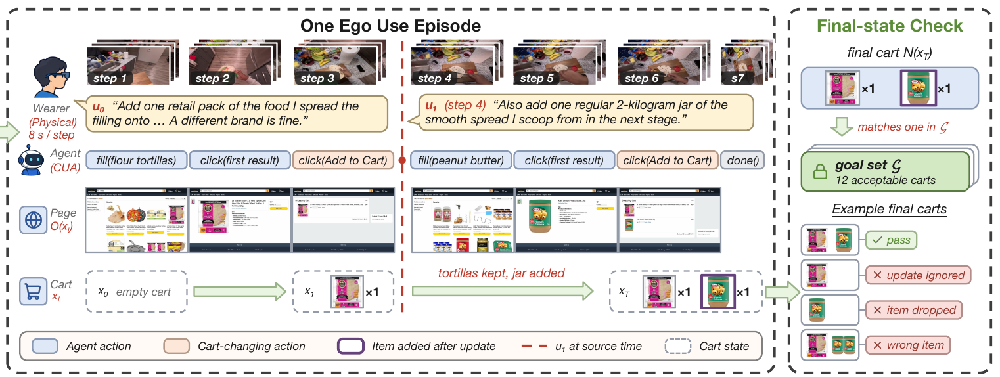

<h1 align="center">&nbsp; EgoUseBench</h1>

<p align="center"><strong>动态第一人称情境下的电脑操作智能体基准评测</strong></p>

<p align="center">
  <a href="https://arxiv.org/abs/2611.34466"></a>
  <a href="https://yurunchen.github.io/egousebench/"></a>
  <a href="https://huggingface.co/datasets/yurun-chen/EgoUseBench"></a>
  <a href="https://huggingface.co/papers/2611.34466"></a>
</p>

<p align="center">
  <a href="README.md">English</a> · <strong>简体中文</strong> · <a href="#快速开始">快速开始</a>
</p>

## 动态

- **2026-11-25：** 发布 EgoUseBench 的[评测代码](egocua/)和[基准任务定义](data/tasks/)。

## 摘要

智能眼镜等 AI 可穿戴设备让智能体不仅能获取数字环境中的信息，也能感知用户日常活动所在的物理环境。用户可以在做手头的事情时发起电脑任务，不必通过明确指令交代所有细节。智能体可以从第一人称画面中识别与用户请求有关的物体和活动，并据此执行数字任务。我们将这种交互方式称为 **Ego Use**。但第一人称画面受佩戴者视角限制，提供的信息可能不完整或含糊。随着新画面到来，智能体可能需要更新对物理环境和用户意图的理解，并重新判断先前的数字操作是否仍然有效。现有智能体能否可靠地应对这些变化，仍缺乏充分评估。

我们提出 **EgoUseBench**，在三种设置下评估 Ego Use。Computer-Use 依赖明确指令；Offline Ego Use 在执行前提供预录的第一人称画面；Online Ego Use 则在用户意图变化的过程中持续提供观察。我们基于 74 小时以上的真实第一人称录像，在三种设置中共构建了 693 个任务。为记录任务如何变化，我们分别跟踪第一人称观察、用户要求和网站状态。按执行过程中信息变化的方式，任务分为三类：Graft（用户更新要求）、Refresh（出现新的第一人称观察）和 Clarify（智能体主动获取信息）。我们评估了多个先进模型，发现 Online Ego Use 的平均成功率比 Computer-Use 低 26.3%。这一结果表明，在第一人称情境和用户意图不断变化时，让任务执行始终与二者保持一致并不容易。

## 70 秒看懂 EgoUseBench

用户可能中途改主意，眼前的场景可能改变该买的商品，模糊的要求可能需要先问清楚。短片用真实第一人称画面和智能体运行记录演示这三种变化，说明同一批任务如何分别以文字、预先给出的视频和边做边看的方式交给智能体，最后给出第一人称画面带来的难度变化。

https://github.com/user-attachments/assets/ecda234c-6fe5-43e3-93a7-13bc1a9bb022

## 快速开始

使用 [uv](https://docs.astral.sh/uv/) 和 Python 3.11+。不需要任务数据或模型凭据，就能检查任务定义并预览项目网站：

```bash
uv sync
uv run egocua validate data/tasks
uv run python -m website
```

打开 [http://127.0.0.1:5050](http://127.0.0.1:5050)。需要换端口时，设置 `WEBSITE_PORT`。

**运行评测。** 另需配套任务画面、Chrome 和 OpenAI 兼容的模型服务。画面的获取条件和许可见[来源登记](configs/datasets.json)。将 `.env.example` 复制为 `.env`，再填写 `OPENAI_BASE_URL` 和 `OPENAI_API_KEY`。

```bash
uv run python -m egocua.study_cli --model <model> --export experiments/
uv run python -m egocua.study_cli --study-from experiments/<冻结目录> --run-all
uv run egocua inspect-run <运行目录> --view score
```

单变化任务的默认上限为 **20 步**，组合任务为 **30 步**。运行本地测试用 `uv run pytest -q`；首次运行浏览器测试前执行 `uv run playwright install chromium`。

## 基准概览

三种设置共用 **200 道任务**。Online Ego Use 另有 **93 道组合任务**，合计 **693 个任务实例**，基于 **74 小时以上**的源录像。

| 设置 | 智能体收到什么 | 任务实例 |
| --- | --- | ---: |
| **Computer-Use** | 明确的最终要求，无第一人称画面 | 200 |
| **Offline Ego Use** | 执行前给出第一人称录像与用户要求 | 200 |
| **Online Ego Use** | 执行中陆续收到第一人称画面和用户要求 | 293 |

在线任务包括 **Graft**（用户更新要求）、**Refresh**（新画面带来新证据）和 **Clarify**（智能体提问确认指代）。智能体在 **EgoMart** 购物、在 **EgoMedia** 收藏教程，或在 **EgoMaps** 标记地点。

### 一条任务如何运行

[](assets/egousebench-method.png)

在这条 Graft 任务中，用户中途要求再加一罐花生酱，购物车里的卷饼皮仍然保留。系统检查最终购物车是否满足两条要求。

## 目录结构

| 路径 | 内容 |
| --- | --- |
| [`egocua/`](egocua/) | 时间线、智能体适配、执行循环与终态检查 |
| [`sites/`](sites/) | 三个自托管网站及其冻结目录 |
| [`data/tasks/`](data/tasks/) · [`data/experiments/`](data/experiments/) | 编译后的任务定义、组合任务与评测材料 |
| [`configs/`](configs/) | 评测设置与来源登记 |
| [`tools/`](tools/) · [`tests/`](tests/) | 构建、审核与渲染脚本；离线测试 |
| [`website/`](website/) | 项目网站源码 |

## 引用

```bibtex
@misc{chen2026egousebenchbenchmarkingcomputeruseagents,
  title={EgoUseBench: Benchmarking Computer-Use Agents under Evolving First-Person Contexts},
  author={Yurun Chen and Biao Yi and Qihang Yu and Keting Yin and Shengyu Zhang},
  year={2026},
  eprint={2611.34466},
  archivePrefix={arXiv},
  primaryClass={cs.AI},
  url={https://arxiv.org/abs/2611.34466},
}
```

## 致谢

感谢 Ego2Web、HD-EPIC、CaptainCook4D、EgoOops、HoloAssist、EgoLife 和 EgoSchema / Ego4D 团队提供来源材料，也感谢独立审核者协助核查基准任务。

短片中的第一人称画面节选自 [HD-EPIC（Damen 等，布里斯托大学）](https://doi.org/10.5523/bris.3cqb5b81wk2dc2379fx1mrxh47)（[CC BY 4.0](https://creativecommons.org/licenses/by/4.0/)）和 [HoloAssist（Wang 等，微软）](https://holoassist.github.io/)（[CDLA-Permissive-2.0](https://cdla.dev/permissive-2-0/)）。画面已裁切，原声已移除；旁白和背景音乐为本项目生成。

## 联系

关于基准或研究合作，请发邮件联系[陈雨润](mailto:yurunchen.research@gmail.com)。
