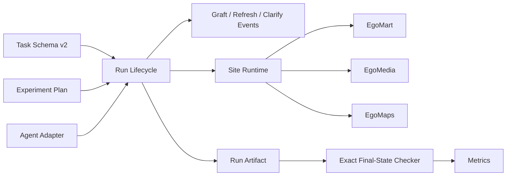

# 代码设计

项目只有一条正式执行链。Browser-Use、人工执行和测试适配器都通过相同的任务协议、站点接口、运行记录和检查器。

## 核心接口

| 模块 | 对外接口 | 职责 |
|---|---|---|
| `egocua.schema` | `load_tasks`、`validate_task`、`validate_dataset` | 检查任务结构和三轨约束 |
| `egocua.environment` | `load_site_data`、`create_site_runtime` | 按 `task.site` 加载并启动网站 |
| `egocua.experiment` | `load_experiment_plan`、`expand_runs` | 生成任务 × 正式运行方式 × 重复次数 |
| `egocua.protocol` | `initial_payload`、`advance`、`ask_user` | 控制画面、指令更新和澄清回答的到达时机 |
| `egocua.execution` | `RunConfig`、`RunContext`、`run_experiment` | 管理一次完整运行 |
| `sites.runtime` | `SiteState`、`SiteServer`、`SiteRuntime` | 四站共享的状态、观察页面和服务器生命周期 |
| `egocua.final_state` | `evaluate_final_state` | 精确比较实体、字段和提交状态 |
| `egocua.checker` | `check_run` | 判断结果并计算过程诊断 |
| `egocua.metrics` | `aggregate`、`bootstrap_intervals` | 汇总任务成功率、过程指标和置信区间 |
| `egocua.review_workspace` | `ReviewWorkspace.open`、`view`、`submit` | 汇集当前任务证据、管理个人进度、绑定版本并保存审核 |
| `egocua.gates` | 人工、评测器、模型和发布检查 | 防止候选任务直接进入正式实验 |

## 设计边界

- 执行器只认识统一站点接口，不包含购物、内容或地图分支。
- 每个网站只负责自己的数据、页面和领域动作。
- 四站统一输出 `selected_entity_ids + fields + submission_completed`。
- 任务只引用站点实体 ID，不复制网页内容。
- 检查器只读取运行记录，不依赖浏览器、模型或参考轨迹。
- `subtype` 不写入任务。Graft 从 `integration_type`、Refresh 从 `policy`、Clarify 从 `valid_slot` 推导分析分组。
- Schema v2 是唯一任务格式，不保留旧字段兼容层。
- 构造审核只有一个 `ReviewWorkspace` seam；Flask 页面只负责展示和接收表单。
- 审核范围来自 `selection.json`，审核进度从个人提交实时计算，不建立第二份索引或进度表。

## 一次运行

1. 执行器读取任务和该轨道唯一的正式运行方式。
2. 根据 `task.site` 加载冻结数据并创建全新网站状态。
3. Agent 收到初始指令和当前可见画面。
4. 每个 Agent 步骤调用 `advance()`；到达搜索结果页或第 8 步时，协议释放预定事件。
5. Clarify 任务可调用一次 `ask_user()`。
6. 网站提交后生成统一最终状态。
7. 运行档案保存提示、画面哈希、事件、网页动作、最终状态和错误信息。
8. 检查器按最终状态判分，并用动作轨迹计算响应时间、重复动作和澄清行为。

每次 `create_site_runtime` 都创建新的内存状态和随机本地端口。网站数据不变，购物车、选择、字段和提交状态不会跨任务保留。
